<p align="center">
  
</p>

<p align="center">
  <strong>Satellites flag the field. Bhumi says why, names the one check that settles it, and seals the evidence so nobody can quietly change it later.</strong>
</p>

<p align="center">
  
  
  
  
</p>

<p align="center">
  <a href="#the-problem">Problem</a> ·
  <a href="#what-bhumi-does">What it does</a> ·
  <a href="#a-walk-through-the-app">Screens</a> ·
  <a href="#how-it-works">How it works</a> ·
  <a href="#why-it-matters-for-the-climate">Impact</a> ·
  <a href="#run-it">Run it</a> ·
  <a href="#honest-limits">Limits</a>
</p>

<p align="center">
  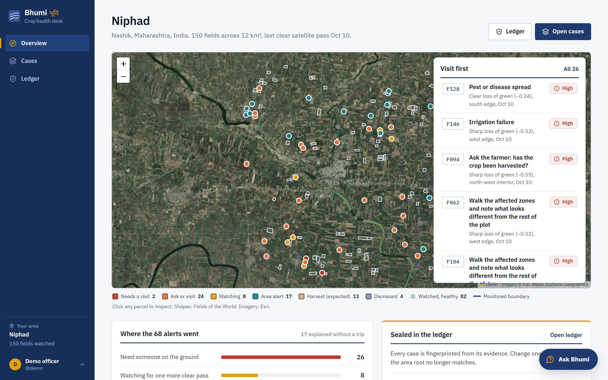
</p>

> Everything in the screenshots runs on real Sentinel-2 imagery and Open-Meteo weather for 150 fields in Niphad, Nashik (Maharashtra, India).

---

## The problem

Environmental monitoring has two weak links, and climate programmes need both fixed at once.

**1. A red patch is not a diagnosis.** Sentinel-2 photographs every field on Earth about every five days for free. When a field loses its green, the picture cannot say whether it is cloud, a harvest on schedule, a heatwave hitting the whole district, or a failing drip line on one farm. Field officers, who each look after hundreds of farms, cannot visit every alert, so they stop trusting the alerts.

**2. Monitoring records are easy to bend.** Soil-carbon, water-stewardship and crop-insurance schemes all depend on field records. Kept in an ordinary database, those records can be edited after the fact, cherry-picked to the good satellite passes, or claimed twice for the same field and season. That is the double-counting and verification problem carbon markets keep running into.

In the shipped Niphad demo area, **68 of 150 fields** raised an alert in three weeks. Bhumi explained **42** without anyone leaving the office. The other **26** arrive with a likely cause, what else it could be, and one cheap check to do on site.

## What Bhumi does

For every alert, Bhumi runs the same three questions an experienced agronomist would:

| Stage | Question | Example outcome |
|---|---|---|
| 1 | **Is the signal real?** Cloud, shadow, haze, or pixels mixing with the land next door. | Field 095: a data artefact on the Oct 2 scene. Dismissed, with the reason on screen. |
| 2 | **Is it expected, or shared with the area?** Harvest season, neighbouring fields, the weather. | 17 fields dropped together in the same hot spell: one area-wide alert, not 17 visits. |
| 3 | **If it is this field alone, what fits?** Rank the causes and pick the cheapest check that tells the top two apart. | Field 128: pest or disease spread, likely. Check: photograph leaf undersides, about 4 minutes. |

Then it **seals the case**. Every piece of evidence is fingerprinted with SHA-256, the fingerprints become a Merkle tree, every case root rolls up into one area root, and that root can be anchored on Ethereum Sepolia. When the officer records what they found, the finding becomes new evidence, the ranking updates, and the root changes, so the history of a case can always be checked.

**Three promises**

- **It shows its own false alarms, with reasons.** Showing the cloud and the harvest it dismissed is what makes the real hits believable.
- **The language model never decides.** Deterministic code turns pixels into evidence and ranks causes. Gemini only writes the plain-language summary, must cite evidence IDs that exist, and is replaced by a template if it does not. Without an API key the app works the same.
- **When it does not know, it asks.** If no cause clears the bar, the answer is "ask or visit" with the cheapest question, never a forced guess.

## A walk through the app

Every image is a screenshot of the running app on real data.

<table>
  <tr>
    <td width="50%">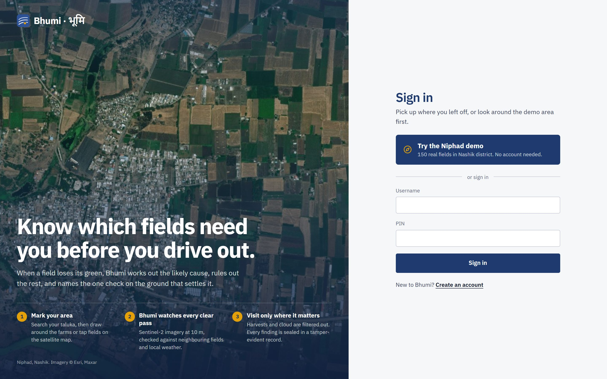<br /><sub><b>Sign in.</b> The Niphad demo is one click, no account needed.</sub></td>
    <td width="50%">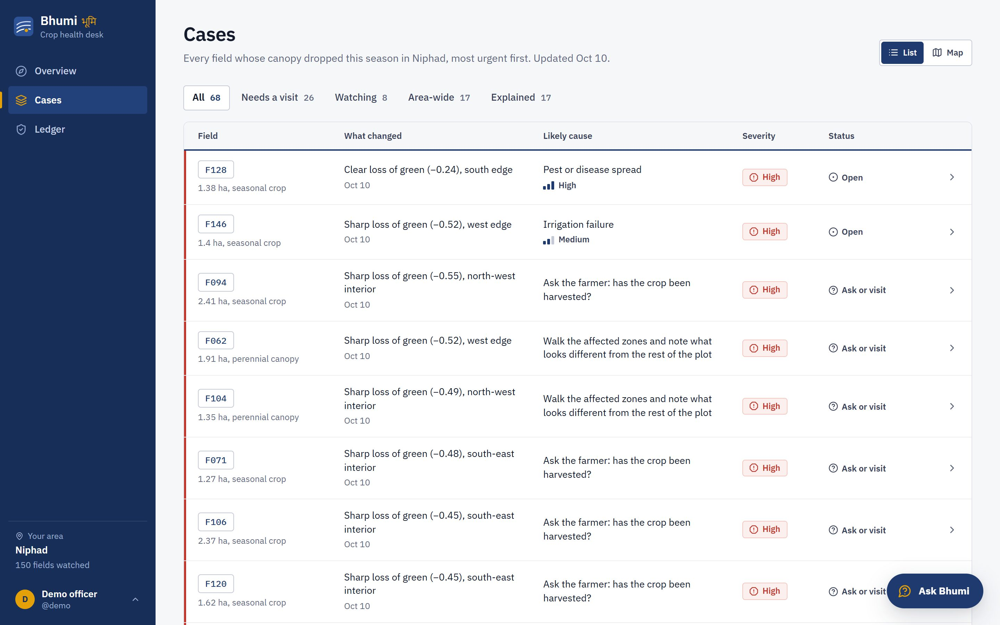<br /><sub><b>Cases.</b> Every alert, most urgent first, with what changed and the likely cause or the question to ask.</sub></td>
  </tr>
  <tr>
    <td><br /><sub><b>A case.</b> Field 128 as its real 10 m pixels. The likely cause in plain words, what else it could be, and the next best check pinned at the bottom.</sub></td>
    <td>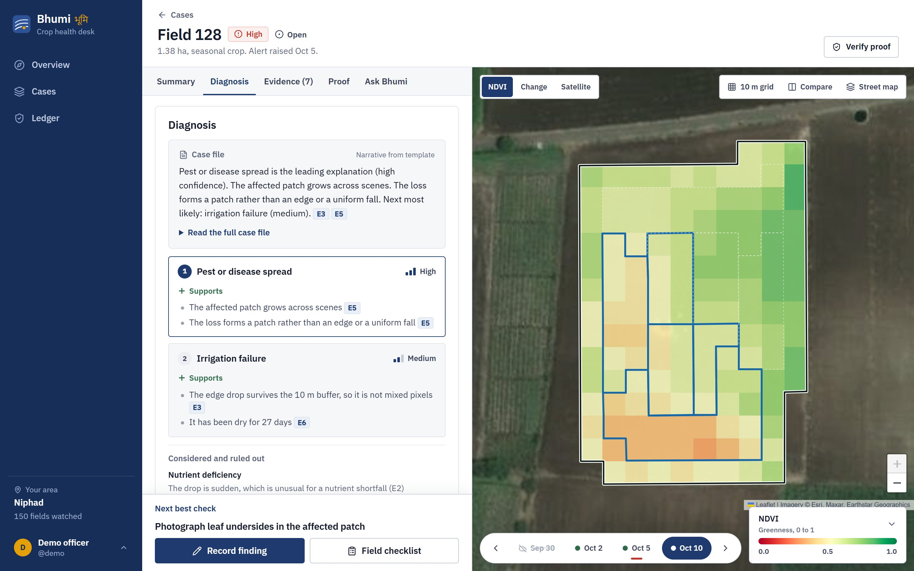<br /><sub><b>Diagnosis.</b> Each cause lists what supports it and what argues against it, every line tied to an evidence ID.</sub></td>
  </tr>
  <tr>
    <td>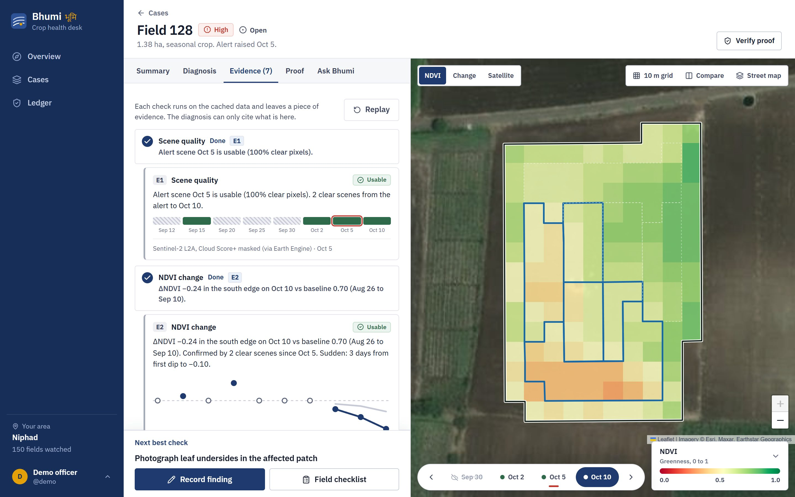<br /><sub><b>Evidence.</b> Seven deterministic checks, each leaving numbered evidence (E1 to E7) with the data it came from.</sub></td>
    <td>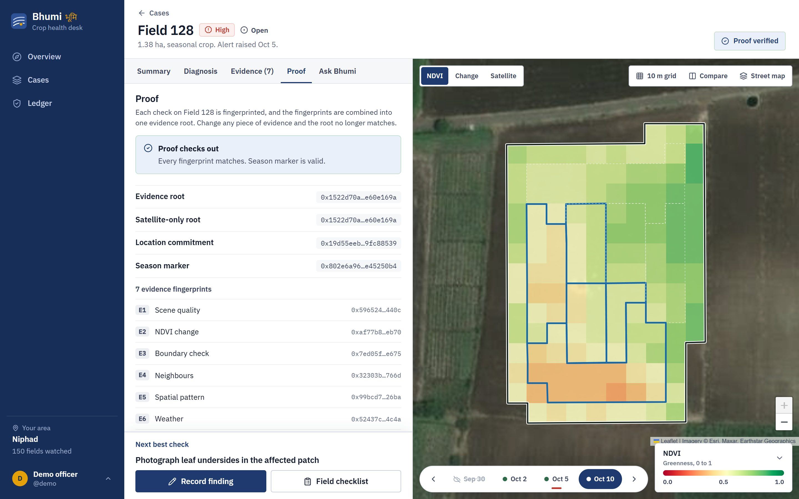<br /><sub><b>Proof.</b> The case's fingerprints and roots, recomputed on demand. "Proof checks out" means nothing was changed.</sub></td>
  </tr>
  <tr>
    <td>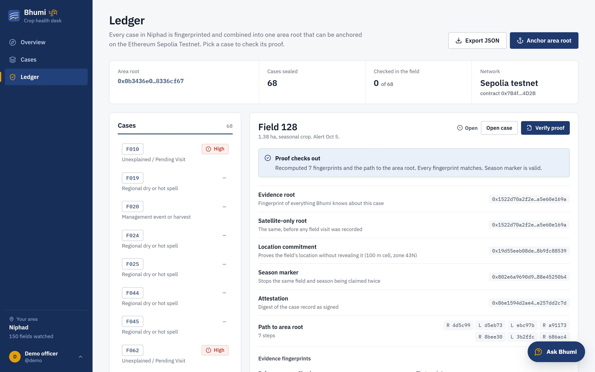<br /><sub><b>Ledger.</b> One area root for every case in Niphad, a proof inspector per case, JSON export, and anchoring on Sepolia.</sub></td>
    <td>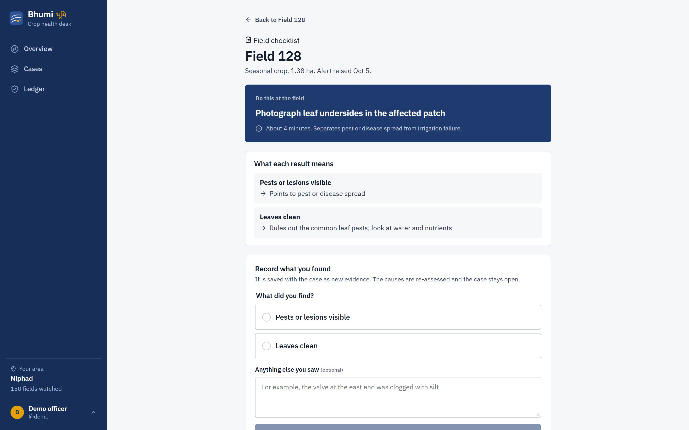<br /><sub><b>At the field.</b> One check, what each result means, and a form. The finding becomes new evidence.</sub></td>
  </tr>
</table>

<p align="center">
  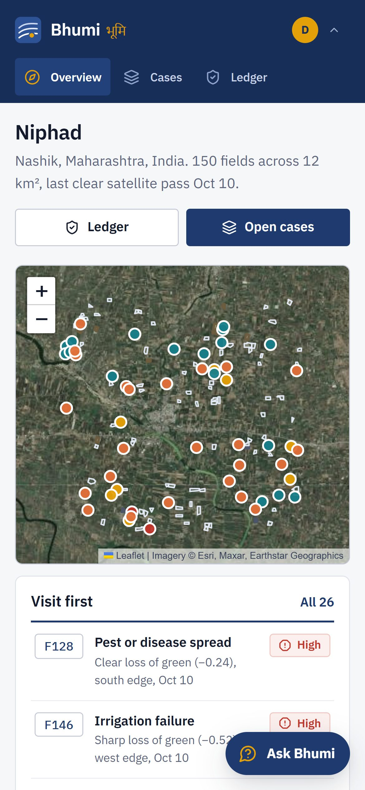
  &nbsp;&nbsp;
  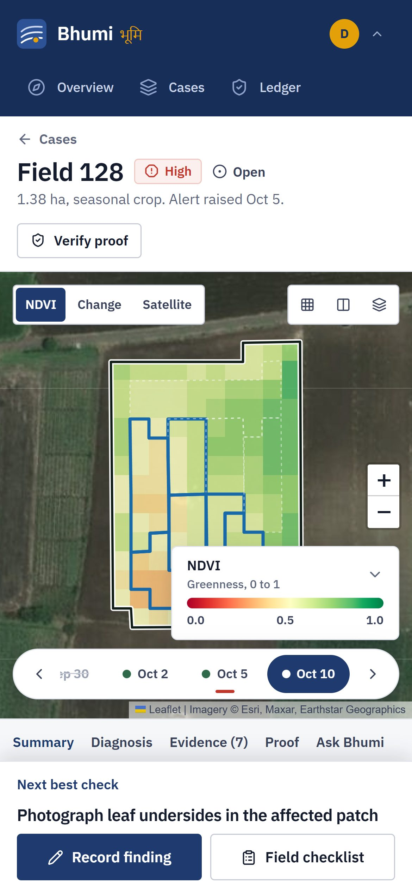
  <br /><sub>Built for a phone in a field as much as a desk in an office.</sub>
</p>

## How it works

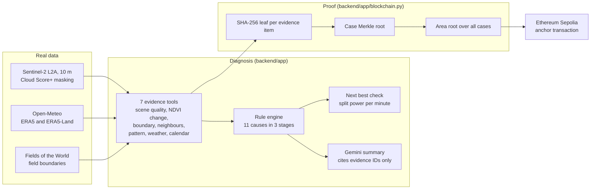

### The diagnosis is deterministic

- **Seven evidence tools** ([`backend/app/tools`](backend/app/tools)) turn pixels and weather into numbered evidence: scene quality, NDVI change by zone, a boundary check with a 10 m inner buffer, comparison with neighbouring fields, the spatial pattern of the loss, weather, and the crop calendar.
- **A rule table** ([`backend/app/engine/rules.py`](backend/app/engine/rules.py)) scores **11 causes** in three stages: data artefacts; expected or area-wide events such as harvest, dry spells and storms; and single-field causes such as irrigation failure, pest or disease, nutrient deficiency and standing water. A missing fact counts neither way and is shown as unknown.
- **The next best check** ([`backend/app/next_check.py`](backend/app/next_check.py)) is computed, not written. Every on-site check in [`data/checks.json`](data/checks.json) is scored by how cleanly its result separates the top two causes, divided by the minutes it takes.
- **Findings reopen the reasoning** ([`backend/app/resolve.py`](backend/app/resolve.py)). A recorded finding moves only the causes it supports or contradicts, and the next check is chosen again.

### The record is tamper-evident

All of this lives in [`backend/app/blockchain.py`](backend/app/blockchain.py) and is covered by tests.

| Piece | How it is built | What it guarantees |
|---|---|---|
| **Evidence leaf** | `SHA-256("bhumi:leaf:v1:" + canonical JSON of one evidence item)` with sorted keys | Changing any reading, date or source changes the leaf. |
| **Case root** | Binary Merkle tree over the leaves; nodes are `SHA-256("bhumi:node:v1:" + left + right)` | One hash commits to all evidence; any item can be proven with its sibling path. |
| **Satellite-only root** | The same tree before any field visit | Shows exactly what the officer's finding added. |
| **Location commitment** | `SHA-256` of the field ID and its centroid rounded to about 100 m | The ledger refers to a field without publishing its exact boundary. |
| **Season marker** (nullifier) | `SHA-256(location commitment + alert date)` | One fixed ID per field and satellite pass, so a registry can refuse a second claim: the double-counting guard carbon markets need. |
| **Area root** | Merkle tree over every case root in the area | One value to anchor on-chain per pass. Each case gets an inclusion path to it. |

**Anchoring.** With a browser wallet such as MetaMask, *Anchor area root* switches to Sepolia and sends a zero-value transaction that carries the area root in its calldata, then records the transaction hash. [`contracts/BhumiClimateRegistry.sol`](contracts/BhumiClimateRegistry.sol) adds a registry on top: `anchorAreaEpoch` stores an area root per pass, `attestFieldFinding` records a case root and marks its season marker as used, and `verifyCaseRoot` checks a case against what was stored.

## Why it matters for the climate

- **Fewer wasted trips.** In the demo, 42 of 68 alerts are settled remotely. Every visit avoided is fuel not burned, and officer time goes to the fields that need it.
- **Earlier action on real stress.** Water stress, pests and waterlogging get a named cause and a 2 to 10 minute check while there is still time to act, protecting smallholder yields and the soil carbon in those fields.
- **Monitoring data a registry can trust.** Sealed, field-checked records with a double-counting guard are what soil-carbon, water-stewardship and parametric-insurance programmes need before they can pay smallholders.
- **Built to scale.** The imagery is free and global, field boundaries come from Fields of the World, and an officer can mark a new area by searching a taluka and drawing around the farms. Nothing is tuned to Niphad.

## At a glance

| Area | What Bhumi brings |
|---|---|
| **Climate impact** | Real Sentinel-2 monitoring of 150 smallholder fields; earlier, targeted action on crop stress; trusted records for carbon and water programmes. |
| **What is new** | Differential diagnosis on satellite alerts, a computed next best check, and a Merkle-sealed evidence trail where a field visit visibly changes the root. |
| **Under the hood** | FastAPI and React app on real data, 7 evidence tools, an 11-cause rule engine, SHA-256 Merkle proofs with in-app verification, Sepolia anchoring, a Solidity registry, and 70 passing tests. |
| **Practical use** | Works on a phone, needs no API key, explains every dismissal, and uses only free global data, so a farmer producer organisation could run it tomorrow. |
| **Verifiable** | The Proof tab and Ledger let anyone check a case against the area root in one click. |

## Run it

**Requirements:** Python 3.11+, Node 18+.

```bash
# 1. Backend
pip install -e "backend[dev]"
python -m pytest backend/tests -q
```

```bash
# 2. API on http://127.0.0.1:8000 (serves the built UI too, once step 3 has run)
python -m uvicorn app.main:app --app-dir backend --port 8000
```

```bash
# 3. Frontend, in a second terminal: dev server on http://localhost:5173
npm --prefix frontend install
npm --prefix frontend run dev
```

Open the app and choose **Try the Niphad demo**. For a single server, run `npm --prefix frontend run build` and open http://127.0.0.1:8000.

Every setting is optional; copy [`.env.example`](.env.example) to `.env` to set them.

| Variable | What it does |
|---|---|
| `GEMINI_API_KEY` | Plain-language summaries and *Ask Bhumi* answers. Without it, a template and retrieval-only answers are used. |
| `BHUMI_LLM=off` | Turn the language model off even if a key is set. |
| `BHUMI_EE_PROJECT` | Google Earth Engine project, for building new areas from fresh imagery. |
| `BHUMI_SEPOLIA_CONTRACT` | Address of your deployed `BhumiClimateRegistry`. |

### API

| Endpoint | Purpose |
|---|---|
| `POST /api/auth/demo` | Start a demo session in Niphad. |
| `GET /api/home` | Area summary, alert counts and the area root. |
| `GET /api/cases`, `GET /api/cases/{id}` | Ranked cases; one case with its evidence, causes and next check. |
| `POST /api/cases/{id}/findings` | Record what the officer found on site. |
| `GET /api/cases/{id}/proof` | Leaves, roots, location commitment, season marker and inclusion paths. |
| `POST /api/cases/{id}/verify` | Recompute every hash and report whether the case still matches. |
| `GET /api/ledger` | Area root, every case entry and recorded Sepolia anchors. |
| `POST /api/ledger/anchor-tx` | Record an anchor transaction for the area root. |
| `POST /api/ask` | *Ask Bhumi*: questions answered from this area's own records. |

### Repository

```
backend/app/tools/      seven evidence tools (pixels and weather to evidence)
backend/app/engine/     rule table and three-stage scoring
backend/app/blockchain.py  leaves, Merkle trees, commitments, verification
contracts/              BhumiClimateRegistry.sol
data/areas/niphad/      the shipped demo area: fields, scenes, weather, cases
frontend/src/           React, TypeScript, Leaflet
docs/screens/           the screenshots in this README
```

## Honest limits

- **The contract is written but not yet deployed.** Anchoring today puts the area root into a Sepolia transaction's calldata; it does not call the contract. Set `BHUMI_SEPOLIA_CONTRACT` once you deploy it.
- **The contract records season markers but does not yet refuse a reused one.** Adding that `require` is a one-line change and the next step for on-chain double-counting protection.
- **Without a wallet, anchoring is simulated.** The app says so and records the result locally. Only anchors made with a wallet exist on Sepolia.
- **The location commitment is coarse, not secret.** It hides a field's exact boundary, but someone who can guess the field ID and the 100 m cell can recompute it. A salted or zero-knowledge commitment is the next step.
- **10 m pixels have limits.** Bhumi sees patterns across a field, not individual plants, and says so on the evidence it shows.
- **One demo area ships in the repo.** New areas build from live Earth Engine and Open-Meteo data, which needs an Earth Engine account.

## Related research

These peer-reviewed papers shaped the proof design. Bhumi implements the simple SHA-256 constructions described above, not the full schemes in the papers.

1. B. B. Sezer, S. Akleylek, U. Nuriyev, "PP-PQB: Privacy-Preserving in Post-Quantum Blockchain-Based Systems: A Systematization of Knowledge," *IEEE Access*, vol. 13, pp. 41382–41405, 2025. [doi:10.1109/ACCESS.2025.3545943](https://doi.org/10.1109/ACCESS.2025.3545943). *Privacy of on-chain records; motivates the location commitment.*
2. M. Iqbal, R. Matulevičius, "Exploring Sybil and Double-Spending Risks in Blockchain Systems," *IEEE Access*, vol. 9, pp. 76153–76177, 2021. [doi:10.1109/ACCESS.2021.3081998](https://doi.org/10.1109/ACCESS.2021.3081998). *Double-spending risks; motivates the season marker.*
3. K. Salah, M. H. U. Rehman, N. Nizamuddin, A. Al-Fuqaha, "Blockchain for AI: Review and Open Research Challenges," *IEEE Access*, vol. 7, pp. 10127–10149, 2019. [doi:10.1109/ACCESS.2018.2890507](https://doi.org/10.1109/ACCESS.2018.2890507). *Sealing the inputs to an AI decision, not only its output.*
4. M. Weiss, F. Jacob, G. Duveiller, "Remote sensing for agricultural applications: A meta-review," *Remote Sensing of Environment*, vol. 236, 2020. [doi:10.1016/j.rse.2019.111402](https://doi.org/10.1016/j.rse.2019.111402). *What vegetation indices can and cannot tell you.*
5. Z. Zhu, S. Wang, C. E. Woodcock, "Improvement and expansion of the Fmask algorithm: cloud, cloud shadow, and snow detection for Landsats 4–7, 8, and Sentinel 2 images," *Remote Sensing of Environment*, vol. 159, 2015. [doi:10.1016/j.rse.2014.12.014](https://doi.org/10.1016/j.rse.2014.12.014). *Why cloud and shadow are screened before any alert.*

**Data:** Copernicus Sentinel-2 via Google Earth Engine with Cloud Score+; Open-Meteo (ERA5, ERA5-Land); Fields of the World field boundaries; ESA WorldCover; basemap imagery © Esri, Maxar, Earthstar Geographics.

## Lineage

Bhumi builds on [FieldDX](https://github.com/SanTiwari07/FieldDX), the same author's earlier satellite crop-diagnosis project. The diagnosis engine and data pipeline come from FieldDX. New in Bhumi: the tamper-evident proof layer (evidence leaves, Merkle roots, location commitment, season marker, area root, in-app verification), Sepolia anchoring, the `BhumiClimateRegistry` contract, the ledger, and a redesigned interface.

## License

[MIT](LICENSE)
